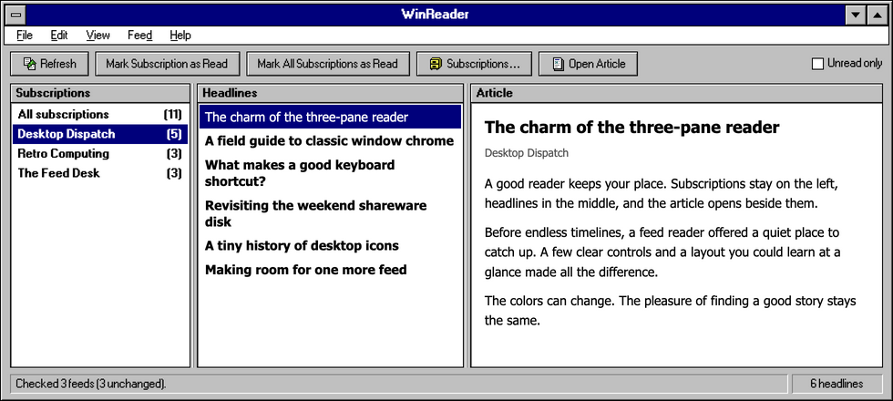
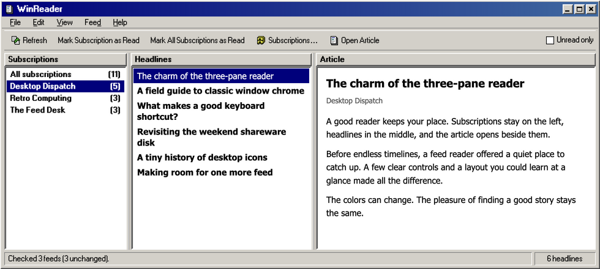
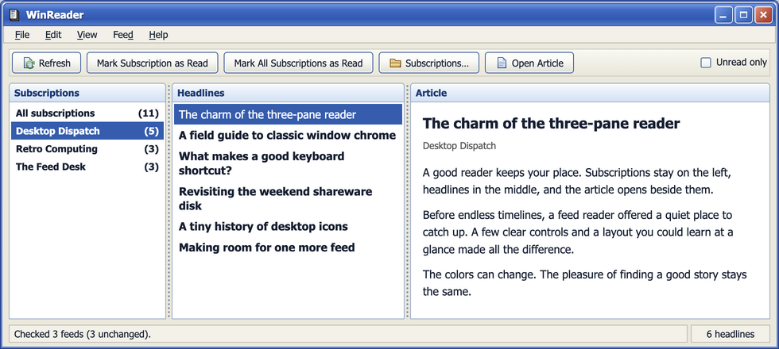
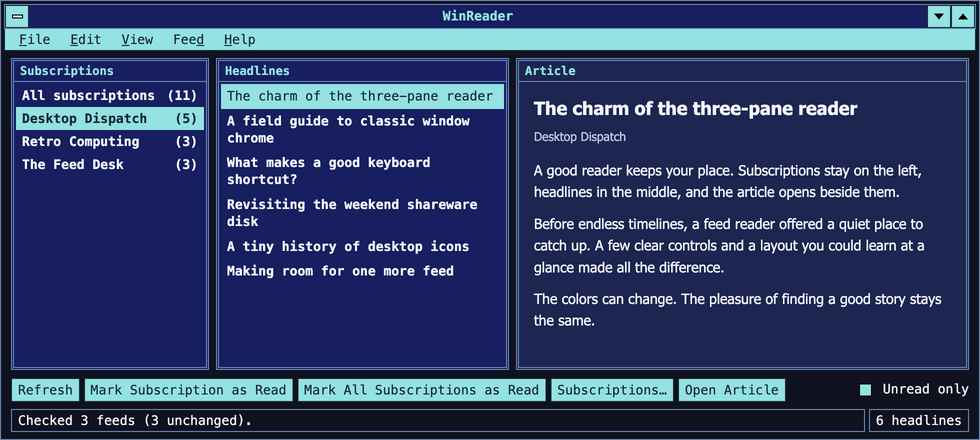

# WinReader

WinReader is a retro desktop reader for RSS, Atom, and JSON Feed. It comes with
retro themes you can switch between under **View → Appearance**.

- **Windows 3.1** brings back gray beveled controls and classic window chrome.
- **Windows 98** pairs a blue gradient title bar with recessed panes and a flat
  icon toolbar. This theme is available when running the feature branch from source.
- **Windows XP (Luna Blue)** adds bright blue title bars and rounded controls.
- **DOS Commander** takes inspiration from Norton Commander with deep-blue panes,
  cyan highlights, and a bottom command strip.

| Windows 3.1 | Windows 98 |
| --- | --- |
| [](docs/screenshots/win31.png) | [](docs/screenshots/win98.png) |
| **Windows XP (Luna Blue)** | **DOS Commander** |
| [](docs/screenshots/xp.png) | [](docs/screenshots/dos.png) |

The reader includes formatted article previews, adjustable text size, unread
tracking, and cached headlines. It ships with a starter set of feeds and can
import subscriptions from an OPML file.

## About this project

I built WinReader as a hobby project and a way to learn what it’s like to build
a desktop app with ChatGPT Codex. I chose the features and the retro look, and
used Codex to help plan, write, debug, and package the app. I’m sharing it for
anyone who enjoys old-school interfaces or wants to explore how it was built.

## Download for macOS

Get the [latest release](https://github.com/dandefenbaugh/WinReader/releases/latest)
for Apple Silicon Macs. Extract the ZIP and open `WinReader.app`.

This build is locally signed and hasn’t been notarized by Apple, so macOS may
block it on first launch. See [Apple’s guidance on opening downloaded apps](https://support.apple.com/en-us/102445).

If you run into a problem or have a suggestion, use [GitHub Issues](https://github.com/dandefenbaugh/WinReader/issues).

## Run from source

With Node.js 22 or newer installed, run:

```sh
npm ci
npm start
```

On macOS, `npm run package:mac` builds a locally signed app in `release/`.

## License


WinReader’s original code is available under the [MIT License](LICENSE).
The bundled fonts are licensed under CC BY-SA 3.0. See the
[font credits](assets/font-credits.txt) for attribution and license details.
Packaged builds include Electron’s license and Chromium’s third-party notices.
